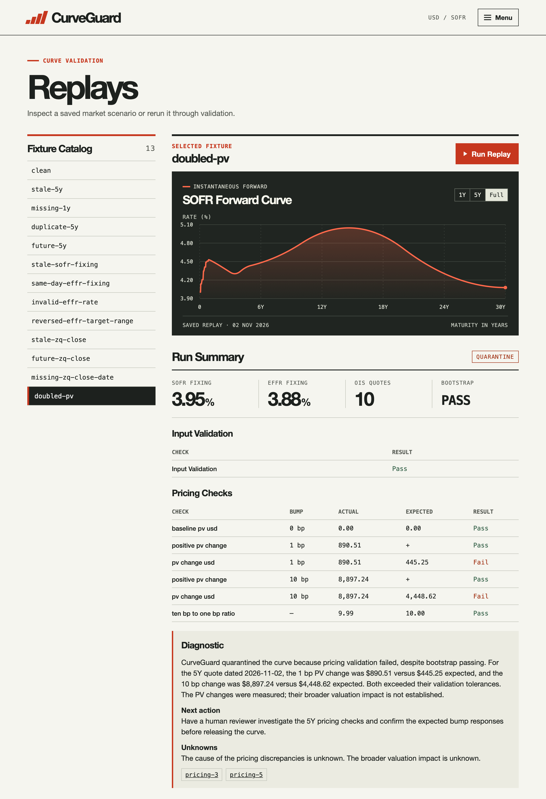

# CurveGuard

CurveGuard builds a USD discount curve for swaps indexed to the Secured Overnight Financing Rate (SOFR). It helps a rates analyst decide whether to release the curve for pricing or hold it for investigation. The C# engine returns `PASS` or `QUARANTINE`, and a Blazor dashboard shows the checks behind that decision. On a quarantine, an optional OpenAI diagnostic explains the evidence and suggests what to inspect next.

## Business use case

It models the daily review of a curve before a desk uses it to value swaps or report how much money it would gain or lose if rates moved.

Consider the `doubled-pv` replay. The curve fits its market quotes, and a 10 basis point move produces almost exactly ten times the change in present value (PV) of a 1 basis point move. Both checks look healthy. But on a $1 million swap, the reported change for the smaller move is **$890.51** against an expected **$445.25**. The larger move is also about twice its expected dollar amount. CurveGuard quarantines the run and shows both discrepancies so an analyst can reconcile the reported sensitivity before using it. [Worked example and analyst review](Evaluations/doubled-pv.md)



## Try it locally

Install the **.NET 10 SDK** and run these commands from the repository root.

```sh
dotnet restore CurveGuard.sln
dotnet run --project CurveGuard.Web
```

Open [the local dashboard](http://localhost:5186). The quickest tour uses **Replays** in the hamburger menu. Select a fixture to inspect its saved report immediately. This works without market-data access or an OpenAI key. Select **Run Replay** to run the saved inputs through the current engine.

| Try these in order | Decision | Bootstrap | What to look for |
| --- | --- | --- | --- |
| [`clean`](Evaluations/replays-eval1/clean.json) | PASS | PASS | The pricing checks pass and the run saves a [forward-curve chart](Evaluations/replays-eval1/clean.png). A clean run skips the AI call. |
| [`stale-5y`](Evaluations/stale-5y.md) | QUARANTINE | SKIPPED | The 5-year quote is dated October 30 for a November 2 valuation. Input validation stops the run before pricing. |
| [`doubled-pv`](Evaluations/doubled-pv.md) | QUARANTINE | PASS | The curve built successfully. The dollar sensitivity checks failed. |

For a **live run**, open **Live Runs**, choose a business date in the calendar, and select **Run Live Curve**. This fetches market data for the selected date. November 19, 2026 is a sample valuation date. Live coverage depends on the providers having quotes for that date and on the bundled 2026–2027 meeting calendar.

### Command line

```sh
dotnet run --project CurveGuard.csproj -- REPLAY=clean
dotnet run --project CurveGuard.csproj -- REPLAY=doubled-pv
dotnet run --project CurveGuard.csproj -- REPLAY=ALL
```

Use any fixture name from the dashboard in place of `clean`. `REPLAY=ALL` runs the clean baseline and all 12 failure cases. Running the CLI without arguments uses the live workflow with its configured valuation date of November 19, 2026. Use the dashboard to select another date.

### Optional OpenAI diagnostics

To generate a fresh explanation on a quarantined run, create a file named `.env` beside `CurveGuard.csproj`. Replace both placeholders with your own values. The model must support structured JSON output on the Responses API.

```dotenv
OPENAI_API_KEY=your-api-key
OPENAI_MODEL=your-model-id
```

CurveGuard also reads these variables from the environment. If the key or model is missing, the report still contains the decision and failed checks, with the reason the diagnostic was unavailable.

## How a run works

| Stage | Implementation |
| --- | --- |
| Market inputs | CurveGuard fetches SOFR and the effective federal funds rate (EFFR) from the New York Fed, USD overnight indexed swap (OIS) quotes from CheckMySwap, and 30-day federal funds futures (ZQ) closes from Yahoo Finance. The fixings use the previous business day. The swap quotes and futures closes are checked against the valuation date. [Data sources](DataRetrivals/) |
| Input validation | Checks observation dates, missing or duplicate swap tenors, the required one-year anchor, and the EFFR rate and target range. A failure records the finding and skips the bootstrap. [Input checks](CurveValidation/CurveInputValidation.cs) |
| Curve construction | Futures-implied rate moves at scheduled Federal Open Market Committee meetings shape the first year of the curve. QuantLib calibrates this path to the one-year OIS quote, fits longer maturities to swap quotes, and checks repricing and forward-rate continuity at the one-year join. [Meeting-rate calculation](FOMCCalculator.cs) · [SOFR curve](SOFRCurve.cs) |
| Pricing validation | Prices a $1 million, five-year pay-fixed swap at the baseline market coupon. It bumps the five-year quote by +1 and +10 basis points, rebuilds the curve, and checks baseline PV, direction, dollar change, and the ratio of the two moves. Expected dollar changes use the repriced swap’s fixed-leg annuity. [Pricing checks](CurveValidation/CurveRiskValidation.cs) |
| Diagnosis | For quarantined runs, the model receives structured validation evidence and returns an explanation, evidence IDs, unknowns, and one next action. CurveGuard checks the cited IDs before displaying the explanation. [Diagnostic logic](CurveDiagnostic/) |

## Reports, tests, and evaluations

Live reports are written to `reports/sofr-forward-YYYY-MM-DD.json` or `reports/sofr-quarantine-YYYY-MM-DD.json`. Replay reports go to `reports/replays/<fixture>.json`. Each report records the inputs, validation decision, and curve when available. Passing runs also produce a PNG chart. Rerunning the same case replaces its local report. [Archived example reports and chart](Evaluations/replays-eval1/)

```sh
dotnet test CurveGuard.sln
```

The automated tests exercise saved input failures, swap repricing under bumps, and diagnostic evidence handling. They use a simulated OpenAI response and require no API key. The 12 manual evaluation sheets review model output for factual accuracy, appropriate citations, and a useful next action. [Unit tests](tests/CurveGuard.Tests/) · [Replay inputs](examples/) · [Manual evaluations](Evaluations/)
